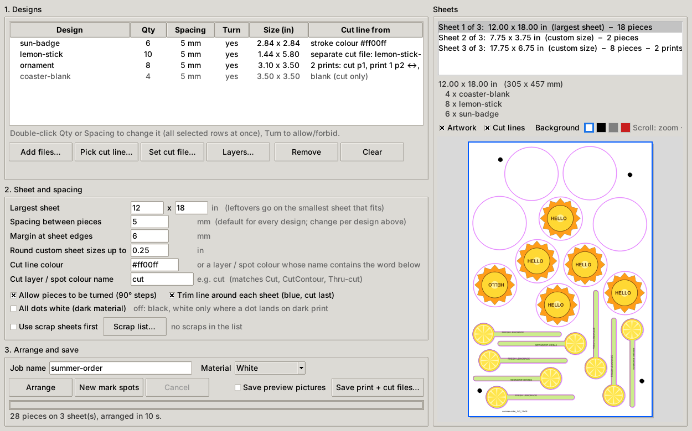
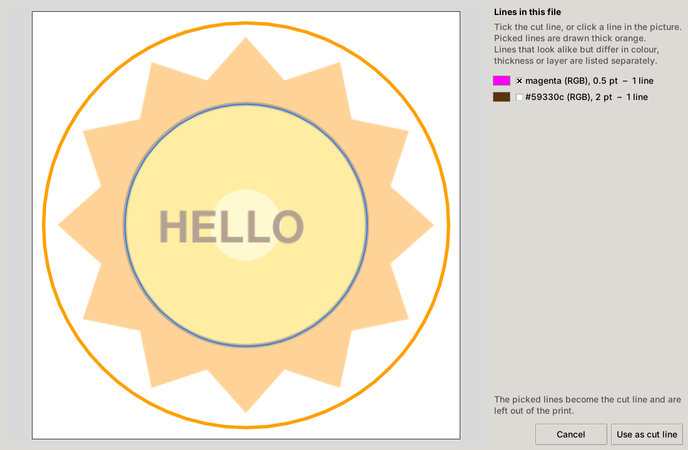
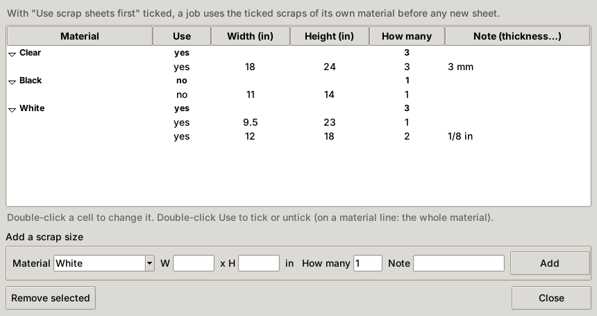
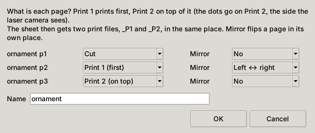
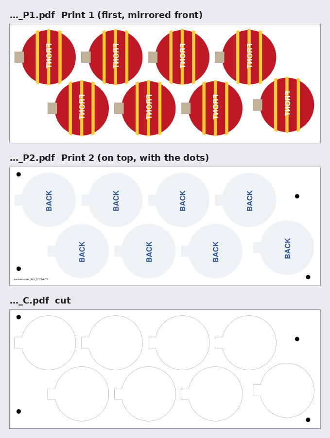
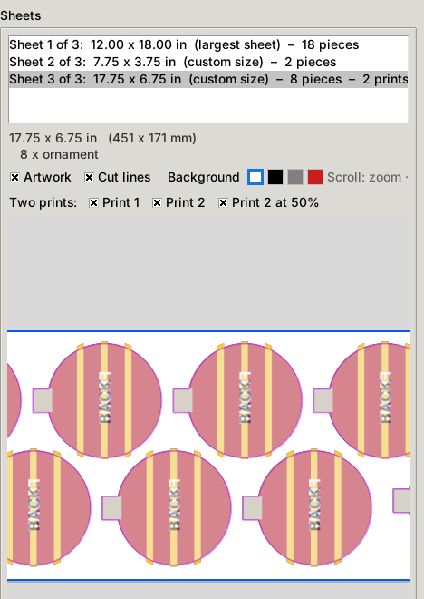
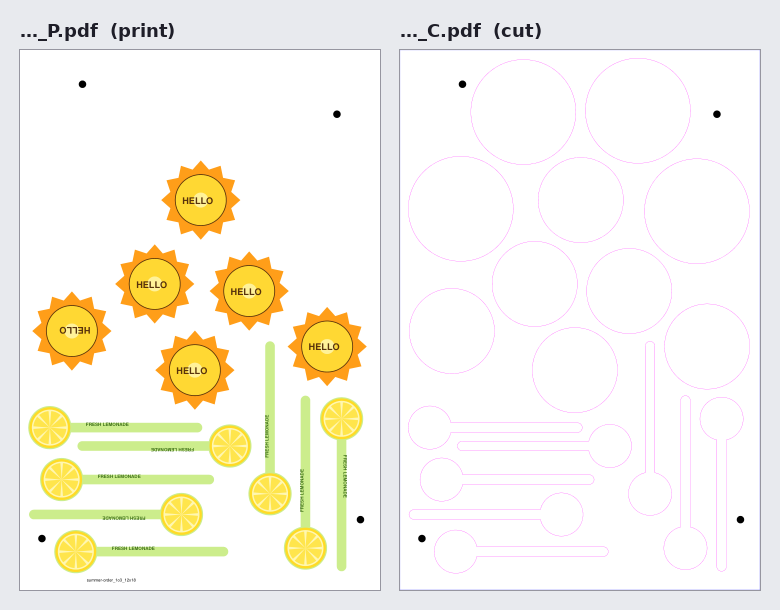

# SheetMaker manual

SheetMaker lays out print & cut designs on sheets and writes, for every sheet, a **print PDF** for your
printer and a **cut PDF** for your laser, with four registration dots so the laser can find the printed
pieces. It works with [LaserVision](https://github.com/jkktech/laservision) and with LightBurn's
*Camera Print & Cut* (four dots, found by the head camera) or classic *Print and Cut*.

Contents

1. [Install and start](#1-install-and-start)
2. [Preparing your design files](#2-preparing-your-design-files)
3. [The main window](#3-the-main-window)
4. [Adding designs](#4-adding-designs)
5. [Quantity, spacing and turning](#5-quantity-spacing-and-turning)
6. [Sheet and spacing settings](#6-sheet-and-spacing-settings)
7. [Scrap sheets](#7-scrap-sheets)
8. [Arrange and preview](#8-arrange-and-preview)
9. [Two prints on one piece (Layers…)](#9-two-prints-on-one-piece-layers)
10. [Saving: the files you get](#10-saving-the-files-you-get)
11. [Printing](#11-printing)
12. [Cutting with LaserVision](#12-cutting-with-laservision)
13. [Cutting with LightBurn Print and Cut](#13-cutting-with-lightburn-print-and-cut)
14. [Several computers](#14-several-computers)
15. [Updating](#15-updating)
16. [Troubleshooting](#16-troubleshooting)

---

## 1. Install and start

SheetMaker runs on Windows with Python 3.

1. Install **Python 3** from [python.org](https://www.python.org/downloads/). In the installer tick
   **Add python.exe to PATH**.
2. Download SheetMaker (**Code → Download ZIP** on GitHub) and unzip it to a folder of your choice:
   `C:\SheetMaker`, or a network drive if several computers should use it (see
   [Several computers](#14-several-computers)).
3. Double-click **Install add-ons.bat**. It installs the four add-ons SheetMaker needs: pymupdf, numpy,
   opencv-python and pikepdf.
4. Double-click **Start SheetMaker.bat**.

Other ways to start it:

- **Create desktop shortcut.bat**: run it once for a desktop shortcut.
- **SheetMaker.exe**: right-click → *Pin to taskbar* or *Pin to Start*. Keep it in the SheetMaker
  folder, or copy it anywhere on your computer: it then asks once where `Start SheetMaker.bat` is (paste
  a path like `\\server\share\SheetMaker` or `S:\SheetMaker` into the Open window, or browse to it).
  You can also put a text file `SheetMaker folder.txt` next to the exe with that path on its first
  line. Hold **Shift** while starting it to choose the folder again.

If something doesn't start, open a Command Prompt in the SheetMaker folder and run
`"Start SheetMaker.bat" console` to see the error message.

## 2. Preparing your design files

SheetMaker reads **PDF** files, and **Illustrator .ai** files saved with *Create PDF Compatible File*
ticked. Draw each design at its real size, one design per artboard / page.

A design can come in three ways:

| You have | How SheetMaker finds the cut line |
|---|---|
| **One file** with artwork and cut line | A **magenta stroke** (#ff00ff, RGB, or CMYK 0/100/0/0), or a **layer or spot colour with "cut" in its name** (Cut, CutContour, Thru-cut…). The colour and the word can be changed in the settings; the colour can be a list (see [Cut colours](#cut-colours)). |
| **Two files**: print file + cut-only file | Every line in the cut file is cut. Pick both files together; they are paired by name (`sticks-1.pdf` + `sticks-cut.pdf`). If the cut artboard is smaller than the print artboard (bleed added to the print), the cut is centred on the print. |
| **A blank**: only a cut file | Cut but not printed (e.g. plain coasters). Shares sheets with printed designs. |

**Print-ready exports with printer's marks.** Exporting a selection as a print-ready PDF (VectorCraft,
Illustrator…) often adds crop marks, registration targets, colour bars and a file-name / date line around
the artboard. SheetMaker takes these off by itself when it loads the file: everything lying completely
outside the artboard is removed, and the page is trimmed to the artboard plus whatever art, bleed or cut
line reaches into it. The artwork isn't changed. The design shows a note "Printer's marks taken off…".

Tips

- Use a cut-line colour that doesn't appear anywhere in the artwork.
- Add **bleed** (art running past the cut line). SheetMaker trims each piece's art to its cut line plus
  half the spacing, so bleed never runs onto a neighbour.
- Closed cut lines nest best. Open paths are cut too; SheetMaker notes them under the design list.
- A PDF with several pages becomes one design per page (`name p1`, `name p2`…).

Try it with the sample designs in [`docs/samples`](samples): `sun-badge.pdf` (one file, magenta cut
line), `lemon-stick.pdf` + `lemon-stick-cut.pdf` (pair), `coaster-blank.pdf` (blank) and
`ornament.pdf` (three pages for [Layers…](#9-two-prints-on-one-piece-layers)).

## 3. The main window



- **1. Designs** (top left): your designs with their quantity, spacing, turning, size and where the cut
  line came from. Rest the mouse on a name to see a picture of the design.
- **2. Sheet and spacing**: sheet size, spacing, margins, cut-line colour, dots and scrap sheets.
- **3. Arrange and save**: job name, material, **Arrange** and **Save print + cut files…**.
- **Sheets** (right): the sheets of the last Arrange and a preview of the selected one.

## 4. Adding designs

Press **Add files…** and pick your design files (several at once is fine).

- Designs in **orange** have *no cut line yet*. Give them one with **Pick cut line…** or
  **Set cut file…** before you Arrange.
- Designs in **gray** are blanks (cut only).

### Cut colours

Different programs export the cut line in different colours (magenta, red…). Two ways to handle that:

- **Cut line colour** (in *Sheet and spacing*) takes a **list**, e.g. `#ff00ff, #ff0000`. Each file uses the
  **first colour in the list that it has** as its cut line; lines in the other listed colours stay in the
  print. So a magenta-cut file with red lines in its artwork still cuts only the magenta.
- **Cut colours…** (next to that box) sets the cut line of **all orange designs at once**. It lists every
  line colour found in them, with the line widths and how many designs have each. Tick the colour that is the
  cut line and press **Apply**: each design takes the first ticked colour it has, and the rest stay orange.
  *Also add the ticked colour(s) to the Cut line colour list* (on by default) makes them found by themselves
  next time.

### Pick cut line…

If no cut line was found, or the wrong one, select the design and press **Pick cut line…**.



Every kind of line in the file is listed by colour, thickness and layer. Tick the cut line, or click a
line in the picture; picked lines are drawn thick orange. Lines with the same colour but a different
thickness or layer are listed separately, so a black cut line can sit next to black art outlines. The
picked lines become the cut line and are left out of the print.

### Set cut file…

Gives the selected design(s) a separate cut file. Select **several designs** (Ctrl- or Shift-click), for
example all pages of a multi-page print file, to give them all the same cut file at once. If the cut
file has one page per selected design, you can choose to pair them page by page instead.

### Remove / Clear

**Remove** takes the selected designs off the list; **Clear** empties it.

## 5. Quantity, spacing and turning

- **Qty**: double-click to set how many pieces of the design you need. 0 leaves it out.
- **Spacing**: double-click to give one design its own gap between pieces (empty = the job's spacing).
- **Turn**: click to stop a design from being turned (grain, direction of a texture, text that must stay
  upright).

With several rows selected, a new Qty or Spacing goes to all of them.

## 6. Sheet and spacing settings

| Setting | What it does |
|---|---|
| **Largest sheet** (W x H, in) | Your full sheet size. Full sheets are filled first. Default 23 x 35 in. |
| **Spacing between pieces** (mm) | Gap from cut line to cut line. Default 5 mm. |
| **Margin at sheet edges** (mm) | Kept free around the sheet edge. |
| **Round custom sheet sizes up to** (in) | Leftover sheets are rounded up to this step (0.25 in). |
| **Cut line colour** | The stroke colour that marks the cut line in one-file designs (#ff00ff), or a list (#ff00ff, #ff0000): each file uses the first one it has. **Cut colours…** next to it: see [Cut colours](#cut-colours). |
| **Cut layer / spot colour name** | A layer or spot colour containing this word is the cut line ("cut"). |
| **Allow pieces to be turned** | 90° turns allowed for all designs (each design can still say no). |
| **Trim line around each sheet** | Adds a blue rectangle around the sheet, last in the cut file. Put blue on its own layer and cut it after the pieces to cut the used area off cleanly. |
| **All dots white (dark material)** | Every dot (and the file name) in white ink. Otherwise dots are black, and a dot landing on dark print is made white. |

## 7. Scrap sheets

**Scrap list…** keeps the leftover sheets you want used up first, grouped by material.



- **Add a scrap size**: material, width, height, how many and a note (thickness…).
- Double-click a cell to change it. Double-click **Use** to keep a scrap back (or a whole material).
- To use scraps: tick **Use scrap sheets first** (it is off each time SheetMaker starts) and choose the
  job's **Material** next to the job name. Arrange then fills scraps of that material before any new
  sheet. When the rest fits on one scrap, only a full-width strip of it is used, so what remains is a
  clean rectangle.
- After saving, SheetMaker asks whether to take the used scraps off the list, and which leftover pieces
  to add to it (tick each one).
- Material **Black** turns on white dots by itself.

## 8. Arrange and preview

Type a **Job name** (it starts every file name) and press **Arrange**.

- Full sheets of the largest size are filled first.
- What's left goes on the **smallest custom sheet** that holds it, rounded up to 0.25 in. It may be
  turned sideways (e.g. 29 x 21.5 in).
- Several layouts are tried (interlocking, straight grid, rows lined up at the bottom, columns lined up
  on the left, free placement) and the one needing the least material wins.
- Each sheet gets four registration dots near the corners, at random spots that differ on every sheet.
  The layout is checked so the sheet can't be mixed up when turned. **New mark spots** arranges again with
  new spots.

The **Sheets** list shows each sheet's size and pieces. Click one to preview it:

- **Artwork** / **Cut lines** turn either off.
- The colour squares change the background behind the art (white, black, gray, red; preview only), to
  check white ink and text on coloured material.
- Scroll to zoom, drag to move, double-click to fit.

## 9. Two prints on one piece (Layers…)

Some pieces are printed twice, one print on top of the other. For example a clear acrylic ornament:
the front art is printed first, **mirrored**, and the back art is printed on top of it. Your file then has
three pages of the same size: the cut line, the front and the back.

Select the pages in the design list (Ctrl-click) and press **Layers…**:



For each page choose what it is: **Cut**, **Print 1 (first)**, **Print 2 (on top)** or *Not used*, and
whether to **Mirror** it (left ↔ right or top ↕ bottom, in its own place). The cut page may be smaller than
the print pages (bleed); it is centred on them. SheetMaker guesses the page
with the least ink as the cut page. Mirror the cut page too if the art it belongs to is mirrored. The
pages become one design with one quantity.

These designs always get **sheets of their own**, and each such sheet gets three files of the same page
size: `_P1` (Print 1, artwork only), `_P2` (Print 2, with the dots and file name: the side the laser
sees) and `_C` (the cut).



In the preview of a two-print sheet, the **Two prints:** row turns **Print 1** and **Print 2** on and off.
**Print 2 at 50%** shows the top print see-through over Print 1: zoom in with the cut lines on to check
that the prints line up and the right page was mirrored the right way.



To print: load `_P1` and `_P2` in your printer software at **the same position** and print P1 first, then
P2 on top (in RasterLink, for example, place both and join them).

## 10. Saving: the files you get

**Save print + cut files…** asks for a folder and makes a subfolder `<job> sheets` with, per sheet:

| File | What it is |
|---|---|
| `<job>_1o2_12x18_P.pdf` | Print: artwork, dots and the file name. Send to the printer at 100 %. |
| `<job>_1o2_12x18_C.pdf` | Cut: cut lines, dots (always black) and the optional blue trim line. |
| `…_P1.pdf` / `…_P2.pdf` | Instead of `_P` on two-print sheets (see [Layers…](#9-two-prints-on-one-piece-layers)). |

`1o2` means sheet 1 of 2; `12x18` is the sheet size in inches. A sheet of only blanks gets no print
file and no dots: cut it directly.



The print file carries its own name (e.g. `summer-order_1o2_12x18`) in small text along a free edge, so
the printed sheet and its cut file are easy to match. It is never in the cut file.

Also in the folder:

- **`<job>_summary.txt`**: per sheet the size, MATERIAL, SCRAP used, LEFTOVER (Keep / Trash, as answered
  after saving), PIECES, and the PRINT and CUT file names:

  ```
  SHEET 3 OF 3: 17.75 x 6.75 in (450.8 x 171.4 mm), 8 pieces
      MATERIAL: White
      SCRAP:    none (new sheet)
      LEFTOVER: none

      PIECES:   8 x ornament

      PRINT 1:  summer-order_3o3_17.75x6.75_P1.pdf  (first)
      PRINT 2:  summer-order_3o3_17.75x6.75_P2.pdf  (on top: dots)
      CUT:      summer-order_3o3_17.75x6.75_C.pdf
  ```

- **`previews/`** (tick *Save preview pictures*; off each time SheetMaker starts): a PNG per sheet with
  the artwork and cut lines.

## 11. Printing

- Print at **100 % / actual size**. Never "fit to page".
- **White ink**: white dots and white text are written as CMYK 0/0/1/0 (1 % yellow) rather than pure white,
  so the printer prints them in white ink instead of treating them as empty background. Set up your RIP
  to print that colour as white.
- Use material of the size in the file name (or a scrap of that size), so the margins and dots fit.

## 12. Cutting with LaserVision

[LaserVision](https://github.com/jkktech/laservision) finds the four dots with a camera and lines the cut
file up with the printed sheet by itself.

1. Put the printed sheet on the laser bed.
2. Open the sheet's **`_C.pdf`** in LaserVision.
3. LaserVision finds the dots, works out where the sheet lies, and cuts. The random dot spots make each
   sheet's orientation unambiguous, so a sheet placed turned is still cut correctly.

See the LaserVision manual for camera setup and calibration.

## 13. Cutting with LightBurn Print and Cut

LightBurn has two ways to line a cut up with a printed sheet. SheetMaker's cut file works with both.

### Camera Print & Cut (four dots, found by the head camera)

LightBurn's newer [Camera Print & Cut](https://docs.lightburnsoftware.com/latest/Reference/CameraPrintAndCut/)
works much like LaserVision: a camera on the laser head finds three or more registration marks and fits the
job to the sheet, even when the sheet is shifted, turned or slightly off in size. Its recommended marks are
**filled circles, four near the sheet corners**. That is what SheetMaker prints: four filled 0.25 in
(6.35 mm) dots, one near each corner, never in a straight line.

You need a gantry laser (not galvo) with a calibrated, aligned **head camera** that has *Include in
Overlay* turned on in the Cameras window.

1. Print the sheet's `_P` file at **100 %**.
2. **Import** the sheet's `_C.pdf` into LightBurn (File → Import) and check that the size matches the size
   in the file name. The dots come in as black filled circles on a layer of their own; the cut lines and
   the blue trim line are on their own layers. Set the cut layers to your cut settings (blue last).
3. Open **Window → Camera Print & Cut**. Check that **Mark Layer** is the dots' layer: LightBurn picks
   a layer that holds only marks by itself, and turns its output off so the dots aren't cut.
4. Dots printed white (*All dots white*, or material Black): tick **Light Marks on Dark Material**.
5. Put the printed sheet in the laser and jog the head so the camera sees the mark named in the yellow
   line (e.g. "Park the head over mark 1").
6. Click **Find Marks**. LightBurn finds the dots one after another and applies the fit when they all
   match.
7. Optional: select a dot and click **Move Laser to Mark** to check the fit without firing.
8. Run the job.

Notes

- **Match**: *Auto* is recommended. *Keep size* only moves and turns the job; *Resize and stretch* uses all
  four dots to correct a print that came out stretched.
- A dot that isn't found: jog near it and click **Search Here**, or **Skip** it (at least three must remain).
- LightBurn needs all the dots alike: all dark, or all light. Normally SheetMaker's dots are black and sit
  on bare material near the corners. If one lands on dark artwork it's printed white instead, so for
  LightBurn tick **All dots white** for dark material, or check the preview that all four dots are black.
- **Reset** turns the fit off again. Camera Print & Cut and the classic two-target Print and Cut replace
  each other.

### Classic Print and Cut (two targets, by hand)

Without a head camera, LightBurn's
[Print and Cut](https://docs.lightburnsoftware.com/2.1/Reference/PrintAndCut/) lines a design up from
**two** targets that you show it with the laser. Any single selectable object works as a target and
LightBurn uses its centre, so use two of SheetMaker's dots.

1. **Import** the sheet's `_C.pdf` (File → Import) and check the size. Put the **dots** on a layer that
   won't cut, or a Tool layer, and set the cut-line layer (and the blue trim layer, last) to your cut
   settings.
2. The laser must be homed and use **Absolute Coordinates**; LightBurn sets that when you start Print and
   Cut. It works on gantry lasers.
3. **Laser Tools → Print and Cut → Start Wizard** (Alt+0).
4. Select the **first dot** in the workspace. Use two dots far apart, e.g. top-left and bottom-right.
5. Jog the laser over the centre of that dot on the printed sheet (red-dot pointer or a low-power pulse)
   and click **Set**.
6. Select the **second dot**, use **Jog To Selection**, fine-tune onto the centre of the printed dot, and
   click **Set**.
7. Choose **No Scaling** (the print is at 100 %), or *Scaled* if your printer is slightly off.
8. Frame to check, then start the job.

The dots are 0.25 in across; aim for their centre. The farther apart the two dots, the more accurate the
result.

## 14. Several computers

Keep SheetMaker on a **network drive** and every computer uses the same `sheetmaker_settings.json` (next
to `Start SheetMaker.bat`).

- Each SheetMaker checks it every 2.5 seconds, so a scrap added or used on one computer shows up on the
  others a few seconds later (also in an open Scrap list window).
- Saving only writes what changed on that computer, so nothing another computer did is lost. If two
  computers change the same scrap before seeing each other's change: a delete wins over an edit; the same
  field edited on both, the last save wins; "How many" changes add up.
- If the drive can't be reached, a red warning shows next to the scrap count, and changes are saved once
  it is back.
- Each computer keeps its own last-used folder (`%LOCALAPPDATA%\SheetMaker\local.json`).

## 15. Updating

Unzip the new `SheetMaker-…` folder into your SheetMaker folder, next to the old ones (right in it, or
one level down). `Start SheetMaker.bat`, the desktop shortcut and `SheetMaker.exe` always open the newest
version, and all versions share the same settings. Each version folder has a `CHANGELOG.md`.

Versions are numbered `a.b.cc.dd`: `a.b.cc` is the base version and `dd` counts its builds.

## 16. Troubleshooting

| Problem | What to do |
|---|---|
| A design is orange ("no cut line yet") | Use **Pick cut line…** or **Set cut file…**. Check the cut-line colour / layer name settings. |
| The wrong lines are cut | **Pick cut line…** and tick only the cut line. |
| "Password protected" | Save the PDF again without a password. |
| An .ai file won't load | Save it from Illustrator with *Create PDF Compatible File* ticked, or as PDF. |
| "does not fit on the sheet" | The design is bigger than the largest sheet minus the margins. Make the sheet bigger or the margin smaller. |
| No file name on a sheet | No free edge was found for it; SheetMaker tells you which sheets. |
| Printed pieces are off from the cut | Print at 100 % (no fit to page); check the material size; in LightBurn use Match *Auto* (Camera Print & Cut) or *Scaled* (classic) if your printer scales slightly. |
| SheetMaker doesn't start | Run `"Start SheetMaker.bat" console` from a Command Prompt and read the message. Run `Install add-ons.bat` again. |
